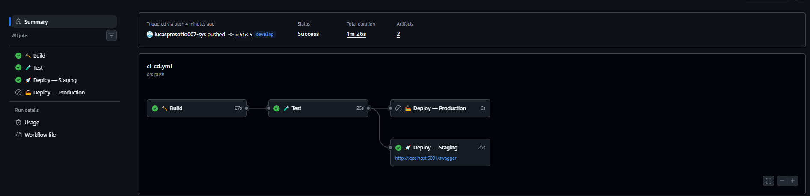
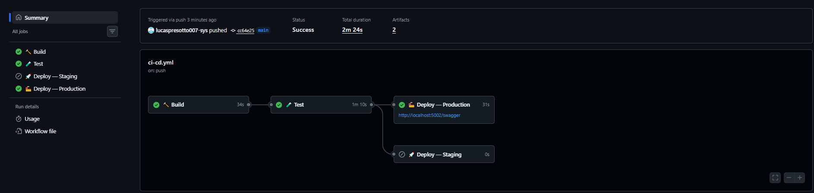

# 🌱 Projeto — Cidades ESG Inteligentes
### Waste Management & Recycling API

API RESTful desenvolvida em **C# .NET 10** para gestão inteligente de resíduos urbanos, alinhada às diretrizes **ESG (Environmental, Social and Governance)**. O sistema permite o monitoramento de lixeiras inteligentes, registro de descartes, rotas de coleta e dicas educacionais sobre reciclagem.

---

## 👥 Equipe

| Nome | RM |
|------|----|
| Lucas Presotto Menotti | RM563647 |
| Sarah Luísa Gaklik | RM565940 |
| Leticia Rosa Batista | RM566266 |
| Natalia Kazue Kikuti | RM565156 |

**Turma:** _(preencher)_ | **Ano:** 2026

---

## 📋 Funcionalidades

- 🔐 **Autenticação JWT** — Registro e login de usuários com roles (Resident, Collector, Admin)
- 🗑️ **Lixeiras Inteligentes** — CRUD completo com alertas de capacidade
- ♻️ **Registro de Descartes** — Rastreamento de descarte por usuário e tipo de material
- 🗺️ **Rotas de Coleta** — Agendamento e gerenciamento de rotas de coleta
- 📚 **Dicas Educacionais** — Banco de dicas sobre reciclagem por categoria de material

---

## 🐳 Como executar localmente com Docker

### Pré-requisitos
- [Docker Desktop](https://www.docker.com/products/docker-desktop/) instalado e em execução
- Git

### Passo a Passo

**1. Clone o repositório**
```bash
git clone https://github.com/lucaspresotto007-sys/WasteManagement.git
cd <seu-repositorio>
```

**2. Configure as variáveis de ambiente**
```bash
# Copie o arquivo de exemplo
cp .env.example .env

# Edite o .env com suas credenciais (o arquivo de exemplo já tem valores funcionais)
# NUNCA faça commit do arquivo .env
```

**3. Suba o ambiente de desenvolvimento**
```bash
docker compose up --build
```

**4. Acesse a aplicação**

| Serviço | URL |
|---------|-----|
| Swagger UI | http://localhost:5000/swagger |
| API Base | http://localhost:5000/api |
| SQL Server | `localhost,1433` |

**5. Primeiros passos na API**

```bash
# 1. Registre um usuário
POST /api/Auth/register
{
  "name": "Seu Nome",
  "email": "seu@email.com",
  "password": "suaSenha123",
  "role": "Resident"
}

# 2. Faça login para obter o token JWT
POST /api/Auth/login
{
  "email": "seu@email.com",
  "password": "suaSenha123"
}

# 3. Use o token no header Authorization: Bearer <token>
```

### Comandos úteis

```bash
# Subir ambiente de staging
docker compose -f docker-compose.staging.yml up --build

# Subir ambiente de produção
docker compose -f docker-compose.prod.yml up --build

# Ver logs da API
docker logs wastemanagement_api -f

# Parar todos os serviços
docker compose down

# Parar e remover volumes (reset do banco)
docker compose down -v
```

### Portas por ambiente

| Ambiente | API | SQL Server | Banco de Dados |
|----------|-----|------------|----------------|
| Development | `5000` | `1433` | WasteManagementDb |
| Staging | `5001` | `1434` | WasteManagementDb_Staging |
| Production | `5002` | `1435` | WasteManagementDb_Prod |

---

## ⚙️ Pipeline CI/CD

### Ferramenta utilizada
**GitHub Actions** — integrado diretamente ao repositório, sem necessidade de infraestrutura adicional.

### Arquivo do pipeline
`.github/workflows/ci-cd.yml`

### Fluxo do pipeline

```
Push para GitHub
       │
       ├── branch: develop ─────────────────────────────────────────────┐
       │                                                                 │
       └── branch: main ────────────────────────────────────────────┐   │
                                                                     │   │
       ┌─────────────┐      ┌─────────────┐                         │   │
       │  🔨 BUILD   │─────▶│  🧪 TEST    │                         │   │
       │             │      │             │                         │   │
       │ dotnet      │      │ xUnit       │                         │   │
       │ restore     │      │ Integration │                         │   │
       │ dotnet      │      │ Tests       │                         │   │
       │ build       │      │ InMemory DB │                         │   │
       └─────────────┘      └──────┬──────┘                         │   │
                                   │                                │   │
                          ┌────────┴────────┐                       │   │
                          │                 │                       │   │
                    (main)│           (develop)                     │   │
                          ▼                 ▼                       │   │
              ┌─────────────────┐  ┌─────────────────┐             │   │
              │  🏭 PRODUCTION  │  │  🚀 STAGING     │◀────────────┘   │
              │                 │  │                 │◀────────────────┘
              │ Valida compose  │  │ Valida compose  │
              │ Build imagem    │  │ Build imagem    │
              │ Deploy simulado │  │ Deploy simulado │
              └─────────────────┘  └─────────────────┘
```

### Descrição dos Jobs

| Job | Trigger | O que faz |
|-----|---------|-----------|
| **🔨 Build** | Qualquer push/PR | `dotnet restore` + `dotnet build -c Release` |
| **🧪 Test** | Após Build | Executa todos os testes xUnit com banco InMemory, publica relatório `.trx` |
| **🚀 Deploy Staging** | Push em `develop` | Valida o `docker-compose.staging.yml`, builda a imagem Docker, simula o deploy |
| **🏭 Deploy Production** | Push em `main` | Valida o `docker-compose.prod.yml`, builda a imagem Docker, simula o deploy |

### Configuração inicial do repositório

```bash
# 1. Inicialize o git na pasta do projeto
git init
git add .
git commit -m "feat: initial DevOps integration"

# 2. Crie o repositório no GitHub e faça o push
git remote add origin https://github.com/lucaspresotto007-sys/WasteManagement.git
git branch -M main
git push -u origin main

# 3. Para testar o pipeline de staging
git checkout -b develop
git push -u origin develop
```

> O pipeline será acionado automaticamente a cada push. Veja os resultados na aba **Actions** do repositório GitHub.

---

## 🐋 Containerização

### Estratégia adotada: Multi-Stage Build

O `Dockerfile` na raiz do projeto utiliza 3 estágios para minimizar o tamanho da imagem final:

```dockerfile
# ─── Stage 1: Build ──────────────────────────────────────────────────────────
# Usa a imagem completa do SDK .NET 10 para compilar o projeto.
# O .csproj é copiado primeiro para aproveitar o cache de camadas do Docker
# (restore só roda novamente se as dependências mudarem).
FROM mcr.microsoft.com/dotnet/sdk:10.0 AS build
WORKDIR /src
COPY ["WasteManagementAPI/WasteManagementAPI.csproj", "WasteManagementAPI/"]
RUN dotnet restore "WasteManagementAPI/WasteManagementAPI.csproj"
COPY . .
WORKDIR "/src/WasteManagementAPI"
RUN dotnet build "WasteManagementAPI.csproj" -c Release -o /app/build

# ─── Stage 2: Publish ────────────────────────────────────────────────────────
# Gera os artefatos otimizados para produção (sem arquivos de debug, sem SDK).
FROM build AS publish
RUN dotnet publish "WasteManagementAPI.csproj" -c Release -o /app/publish /p:UseAppHost=false

# ─── Stage 3: Runtime ────────────────────────────────────────────────────────
# Imagem final MÍNIMA — só o runtime ASP.NET, sem o SDK completo.
# Resultado: ~200MB vs ~800MB com o SDK completo.
# Por segurança, a aplicação roda como usuário não-root (appuser).
FROM mcr.microsoft.com/dotnet/aspnet:10.0 AS final
WORKDIR /app
RUN addgroup --system appgroup && adduser --system --ingroup appgroup appuser
USER appuser
COPY --from=publish /app/publish .
EXPOSE 8080
ENTRYPOINT ["dotnet", "WasteManagementAPI.dll"]
```

### Comparativo de tamanho de imagem

| Abordagem | Tamanho estimado |
|-----------|-----------------|
| Imagem simples com SDK | ~800 MB |
| Multi-stage (apenas runtime) | ~200 MB |
| **Redução** | **~75%** |

### Orquestração com Docker Compose

O projeto possui 3 arquivos de composição:

| Arquivo | Uso | Portas |
|---------|-----|--------|
| `docker-compose.yml` | Desenvolvimento local | API: 5000, DB: 1433 |
| `docker-compose.staging.yml` | Ambiente de homologação | API: 5001, DB: 1434 |
| `docker-compose.prod.yml` | Ambiente de produção | API: 5002, DB: 1435 |

**Recursos utilizados:**
- **Volumes nomeados** — persistência dos dados do SQL Server entre reinicializações
- **Redes isoladas** — cada ambiente tem sua própria bridge network (sem interferência)
- **Healthcheck** — a API só sobe após o banco estar saudável (`depends_on: service_healthy`)
- **Variáveis de ambiente** — todas as credenciais lidas do `.env`, nunca hardcoded
- **`restart: always`** — configurado no ambiente de produção para auto-recuperação

## 📸 Prints do funcionamento

### Pipeline CI/CD — Deploy Staging (branch `develop`)

Pipeline disparado por push na branch `develop`. Build ✅ → Test ✅ → Deploy Staging ✅ — Deploy Production pulado (comportamento esperado).



### Pipeline CI/CD — Deploy Production (branch `main`)

Pipeline disparado por push na branch `main`. Build ✅ → Test ✅ → Deploy Production ✅ — Deploy Staging pulado (comportamento esperado).



> 🔗 Todas as execuções disponíveis em: https://github.com/lucaspresotto007-sys/WasteManagement/actions

---

## 🛠️ Tecnologias utilizadas

### Aplicação
| Tecnologia | Versão | Uso |
|------------|--------|-----|
| C# | 13 | Linguagem principal |
| .NET | 10.0 | Framework |
| ASP.NET Core Web API | 10.0 | Framework HTTP |
| Entity Framework Core | 8.x | ORM / Migrations |
| Microsoft SQL Server | 2022 | Banco de dados relacional |
| JWT Bearer Authentication | 8.x | Autenticação e autorização |
| Swashbuckle (Swagger) | 6.5 | Documentação interativa da API |
| Newtonsoft.Json | 10.x | Serialização JSON |

### Testes
| Tecnologia | Versão | Uso |
|------------|--------|-----|
| xUnit | 2.5.3 | Framework de testes |
| Microsoft.AspNetCore.Mvc.Testing | 8.x | Testes de integração |
| EF Core InMemory | 8.x | Banco em memória para testes |
| Coverlet | 6.0 | Cobertura de código |

### DevOps & Infraestrutura
| Tecnologia | Uso |
|------------|-----|
| Docker | Containerização da aplicação |
| Docker Compose | Orquestração dos serviços (API + DB) |
| GitHub Actions | Pipeline de CI/CD |
| Git | Controle de versão |

---

## 📁 Estrutura do projeto

```
Projetinho/
├── .github/
│   └── workflows/
│       └── ci-cd.yml              # Pipeline GitHub Actions
├── WasteManagementAPI/
│   ├── Controllers/               # Endpoints HTTP
│   ├── Data/                      # DbContext e configurações EF Core
│   ├── Middleware/                # Exception handling global
│   ├── Migrations/                # Migrations do banco de dados
│   ├── Models/                    # Entidades do domínio
│   ├── Services/                  # Lógica de negócio
│   ├── ViewModels/                # DTOs de entrada/saída
│   ├── appsettings.json           # Configurações da aplicação
│   ├── Program.cs                 # Entry point e configuração DI
│   └── WasteManagementAPI.csproj
├── WasteManagementAPI.Tests/
│   ├── AuthControllerTests.cs
│   ├── CollectionRouteControllerTests.cs
│   ├── DisposalControllerTests.cs
│   ├── EducationalTipControllerTests.cs
│   ├── WasteBinControllerTests.cs
│   ├── CustomWebApplicationFactory.cs
│   └── WasteManagementAPI.Tests.csproj
├── Dockerfile                     # Multi-stage build (raiz do projeto)
├── docker-compose.yml             # Ambiente de desenvolvimento
├── docker-compose.staging.yml     # Ambiente de homologação
├── docker-compose.prod.yml        # Ambiente de produção
├── .env.example                   # Template de variáveis de ambiente
├── .gitignore                     # Arquivos ignorados pelo git
├── WasteManagement.slnx           # Solution file
└── README.md                      # Esta documentação
```

---

## ✅ Checklist de Entrega

| Item | Status |
|------|--------|
| Projeto compactado em .ZIP com estrutura organizada | ✅ |
| Dockerfile funcional | ✅ |
| docker-compose.yml com volumes, redes e variáveis de ambiente | ✅ |
| docker-compose.staging.yml e docker-compose.prod.yml | ✅ |
| Pipeline com etapas de build, teste e deploy (GitHub Actions) | ✅ |
| Deploy realizado no ambiente **staging** (branch `develop`) | ✅ |
| Deploy realizado no ambiente **produção** (branch `main`) | ✅ |
| README.md com instruções e prints | ✅ |
| `.env.example` com variáveis documentadas | ✅ |
| Documentação técnica com evidências (PDF ou PPT) | ✅ |

---

## 🌿 Contexto ESG

Este projeto contribui diretamente com os pilares ESG:

- **Environmental (Ambiental):** Monitoramento inteligente de lixeiras reduz coletas desnecessárias, economizando combustível e reduzindo emissões de CO₂.
- **Social:** Gamificação com pontos de reciclagem incentiva comportamentos sustentáveis na comunidade. Dicas educacionais aumentam consciência ambiental.
- **Governance:** Rastreabilidade completa dos descartes e rotas, permitindo relatórios de conformidade e auditoria ambiental.
